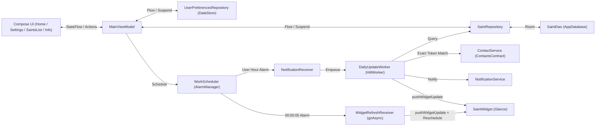

# ARCHITECTURE.md — Architecture & Cartographie du Code

> Ce document décrit les Use Cases de référence, l'architecture cible, le flux de données et l'emplacement exact des fichiers du projet **Bonne Fête** afin d'éviter toute exploration inutile du codebase.

---

## 1. Use Cases Nominaux Validés

- **Acteur** : Utilisateur souhaitant voir le saint du jour sur son écran d'accueil Android et recevoir une notification quotidienne si l'un de ses contacts fête son prénom.
- **Parcours 1 — Affichage et mise à jour automatique du Widget à minuit** :
    1. L'utilisateur ajoute le widget **Bonne Fête** sur son écran d'accueil.
    2. Le widget affiche immédiatement « Bonne Fête ! » et le prénom du saint du jour avec la police médiévale dorée sur fond enluminé, en adaptant automatiquement la taille du texte aux dimensions du widget (`SizeMode.Exact`).
    3. Chaque nuit à `00:00:05` (ainsi qu'lors d'un changement de date/heure système, d'un redémarrage ou d'un cycle `updatePeriodMillis`), `SaintWidget.pushWidgetUpdate()` met à jour le `PreferencesGlanceStateDefinition` (`KEY_DATE_KEY`, `KEY_SAINT_NAME`, `KEY_REVISION`), force la recomposition immédiate du widget **sans nécessiter de redimensionnement manuel**, et reprogramme l'alarme du minuit suivant.
- **Parcours 2 — Notification quotidienne filtrée par les contacts (Correspondance exacte du prénom)** :
    1. À l'heure choisie par l'utilisateur (par défaut `09:00`), `AlarmManager` déclenche `NotificationReceiver` qui lance `DailyUpdateWorker`.
    2. `DailyUpdateWorker` récupère le saint du jour dans Room et interroge `ContactService.getMatchingContacts(saint.name)`.
    3. `ContactService` normalise les noms (sans accents, minuscules), extrait le prénom principal du saint et compare par **mot entier (token exact)** avec les noms du répertoire :
        - Si le saint est *"Clément"*, un contact nommé *"Clément"* ou *"Clément Dupont"* est retenu, mais *"Clémentine"* ou *"Jean-Clément"* est **ignoré**.
    4. Si l'option « Notifier uniquement si dans les contacts » est active et qu'au moins un contact correspond (ou si l'option est désactivée), `NotificationService` affiche la notification personnalisée.
    5. `DailyUpdateWorker` actualise également le widget et reprogramme l'alarme pour le lendemain.
- **Parcours 3 — Consultation du calendrier annuel et configuration** :
    1. Depuis `HomeScreen`, l'utilisateur accède aux **Paramètres** (`MainScreen` : saint du jour, switch filtre contacts, sélecteur d'heure, bouton de test immédiat), au **Calendrier des Saints** (`SaintsListScreen` : liste des 366 jours de l'année), ou à l'écran **Informations** (`InfoScreen` : crédits, site web, réseaux sociaux et PayPal).

---

## 2. Vue d'Ensemble (Clean MVVM, Hilt, Glance & WorkManager)



---

## 3. Organisation des Packages (`fr.antoinehory.bonnefete`)

```text
fr.antoinehory.bonnefete/
├── BonneFeteApp.kt                  # Application @HiltAndroidApp + Configuration.Provider WorkManager + Init alarme minuit
├── MainActivity.kt                  # Activité hôte (SplashScreen, permissions READ_CONTACTS/POST_NOTIFICATIONS, NavHost, MainScreen)
├── di/
│   ├── DatabaseModule.kt            # Fourniture singleton de AppDatabase ("bonne_fete_db") et SaintDao
│   └── WorkManagerModule.kt         # Fourniture singleton de WorkManager
├── data/
│   ├── local/
│   │   ├── AppDatabase.kt           # Base Room (SaintEntity, version 2)
│   │   ├── dao/SaintDao.kt          # Requêtes SQL (saint par jour/mois, insertion initiale, liste complète)
│   │   └── entity/SaintEntity.kt    # Entité Room table "saints" (id, month, day, name, title)
│   └── repository/
│       ├── SaintRepository.kt       # Chargement initial depuis assets/saints.json et exposition des Flows
│       └── UserPreferencesRepository.kt # DataStore Preferences (notification_hour, notification_minute, only_contacts)
├── domain/
│   ├── ContactService.kt            # Recherche dans ContactsContract par token de prénom exact (insensible aux accents)
│   ├── NotificationService.kt       # Création du canal et envoi des notifications quotidiennes
│   └── WorkScheduler.kt             # Programmation AlarmManager (alarme de notification + alarme minuit 00:00:05)
├── ui/
│   ├── MainViewModel.kt             # État UI (MainUiState), liste des saints, mise à jour des préférences et test de notif
│   ├── screens/
│   │   ├── HomeScreen.kt            # Écran d'accueil illustré avec 3 boutons flottants (Paramètres, Liste, Infos)
│   │   ├── SaintsListScreen.kt      # Liste complète des saints de l'année (JJ / MM - Nom)
│   │   └── InfoScreen.kt            # Informations développeur, liens web/email/PayPal et réseaux sociaux
│   └── theme/
│       ├── Color.kt                 # Palette médiévale (MedievalBlue, AntiqueGold, RubyRed, Parchment)
│       ├── Type.kt                  # Typographie utilisant R.font.medieval_font
│       └── Theme.kt                 # BonneFeteTheme (Material 3) et MedievalGlanceColorScheme
├── widget/
│   ├── SaintWidget.kt               # GlanceAppWidget avec PreferencesGlanceStateDefinition, pushWidgetUpdate et downsampling Bitmap
│   ├── SaintWidgetReceiver.kt       # GlanceAppWidgetReceiver (@AndroidEntryPoint) écoutant APPWIDGET_UPDATE et changements de date/heure
│   └── WidgetRefreshReceiver.kt     # BroadcastReceiver (@AndroidEntryPoint) déclenché à minuit avec goAsync() et reprogrammation
└── worker/
    ├── BootReceiver.kt              # BroadcastReceiver (@AndroidEntryPoint) sur BOOT_COMPLETED et MY_PACKAGE_REPLACED
    ├── NotificationReceiver.kt      # BroadcastReceiver déclenchant DailyUpdateWorker
    └── DailyUpdateWorker.kt         # CoroutineWorker (@HiltWorker) : vérifie le saint, filtre les contacts, notifie et rafraîchit le widget
```

---

## 4. Cartographie des Fichiers du Projet

*Mettre à jour ce tableau à chaque création, modification structurante ou suppression de fichier.*

| Chemin relatif | Responsabilité | Statut |
| :--- | :--- | :--- |
| `AGENTS.md` | Point d'entrée IA, index documentaire, catalogue de skills et garde-fous | Actif |
| `docs/ARCHITECTURE.md` | Use Cases, architecture MVVM/Hilt/Glance, spécifications techniques et cartographie | Actif |
| `docs/CODING_STANDARDS.md` | Standards de code Kotlin/Compose/Glance et bonnes pratiques Room/Alarms/Contacts | Actif |
| `docs/ROADMAP.md` | Suivi d'avancement par phases | Actif |
| `docs/DECISIONS.md` | Journal des décisions d'architecture (ADR-001 à ADR-006) | Actif |
| `PLAY_STORE.md` | Fiche Google Play Store complète et notes de version | Actif |
| `README.md` | Présentation du projet, fonctionnalités et commandes Gradle | Actif |
| `CHANGELOG.md` | Historique détaillé des versions (`1.0.0`, `1.1.0`, `1.2.0`) | Actif |
| `POLITIQUE_DE_CONFIDENTIALITE.md` | Politique de confidentialité (traitement 100 % local des contacts) | Actif |
| `gradle/libs.versions.toml` | Catalogue des dépendances (AGP 9.2.0, Kotlin 2.2.10, Hilt 2.59.2, Room 2.8.4, Glance 1.1.1, Work 2.11.2) | Actif |
| `app/build.gradle.kts` | Configuration du module `:app` (`compileSdk = 37`, `targetSdk = 37`, `minSdk = 26`, `versionCode = 3`, `versionName = "1.2.0"`) | Actif |
| `app/proguard-rules.pro` | Règles R8/ProGuard (conservation du constructeur sans argument des `ActionCallback` Glance) | Actif |
| `app/src/main/AndroidManifest.xml` | Permissions (`READ_CONTACTS`, `POST_NOTIFICATIONS`, `USE_EXACT_ALARM`, `RECEIVE_BOOT_COMPLETED`), Activity, Receivers et Provider | Actif |
| `app/src/main/assets/saints.json` | Calendrier complet des saints par mois (`january` à `december`) | Actif |
| `app/src/main/res/xml/saint_widget_info.xml` | Configuration AppWidgetProvider (`updatePeriodMillis = 1800000`, redimensionnable) | Actif |
| `app/src/main/java/fr/antoinehory/bonnefete/BonneFeteApp.kt` | Initialisation Hilt/WorkManager, programmation de l'alarme minuit et push initial du widget | Actif |
| `app/src/main/java/fr/antoinehory/bonnefete/MainActivity.kt` | Activité principale, demande de permissions runtime, navigation et écran de paramètres (`MainScreen`) | Actif |
| `app/src/main/java/fr/antoinehory/bonnefete/di/DatabaseModule.kt` | Module Hilt pour `AppDatabase` et `SaintDao` | Actif |
| `app/src/main/java/fr/antoinehory/bonnefete/di/WorkManagerModule.kt` | Module Hilt pour `WorkManager` | Actif |
| `app/src/main/java/fr/antoinehory/bonnefete/data/local/entity/SaintEntity.kt` | Entité Room `saints` (`id`, `month`, `day`, `name`, `title`) | Actif |
| `app/src/main/java/fr/antoinehory/bonnefete/data/local/dao/SaintDao.kt` | DAO Room (`getSaintForDate`, `insertSaints`, `getCount`, `getAllSaints`) | Actif |
| `app/src/main/java/fr/antoinehory/bonnefete/data/local/AppDatabase.kt` | Définition `RoomDatabase` | Actif |
| `app/src/main/java/fr/antoinehory/bonnefete/data/repository/SaintRepository.kt` | Import JSON vers Room au premier lancement et lecture du saint du jour | Actif |
| `app/src/main/java/fr/antoinehory/bonnefete/data/repository/UserPreferencesRepository.kt` | Gestion DataStore (`notificationTime`, `onlyContacts`) | Actif |
| `app/src/main/java/fr/antoinehory/bonnefete/domain/ContactService.kt` | Correspondance par token de prénom exact entre le saint du jour et le répertoire Android | Actif |
| `app/src/main/java/fr/antoinehory/bonnefete/domain/NotificationService.kt` | Construction et affichage de la notification quotidienne | Actif |
| `app/src/main/java/fr/antoinehory/bonnefete/domain/WorkScheduler.kt` | Programmation des alarmes exactes (heure de notification et rafraîchissement minuit `00:00:05`) | Actif |
| `app/src/main/java/fr/antoinehory/bonnefete/widget/SaintWidget.kt` | Widget Jetpack Glance avec état DataStore (`PreferencesGlanceStateDefinition`) et rendu Bitmap police médiévale | Actif |
| `app/src/main/java/fr/antoinehory/bonnefete/widget/SaintWidgetReceiver.kt` | Récepteur du widget gérant `onUpdate` et les changements système de date/heure/fuseau | Actif |
| `app/src/main/java/fr/antoinehory/bonnefete/widget/WidgetRefreshReceiver.kt` | Récepteur de l'alarme de minuit mettant à jour l'état du widget et reprogrammant le lendemain | Actif |
| `app/src/main/java/fr/antoinehory/bonnefete/worker/BootReceiver.kt` | Récepteur `BOOT_COMPLETED` et `MY_PACKAGE_REPLACED` reprogrammant les alarmes et le widget | Actif |
| `app/src/main/java/fr/antoinehory/bonnefete/worker/NotificationReceiver.kt` | Récepteur d'alarme déclenchant `DailyUpdateWorker` | Actif |
| `app/src/main/java/fr/antoinehory/bonnefete/worker/DailyUpdateWorker.kt` | Worker quotidien de notification, mise à jour du widget et reprogrammation | Actif |
| `app/src/main/java/fr/antoinehory/bonnefete/ui/MainViewModel.kt` | ViewModel principal gérant `MainUiState` et la liste des saints | Actif |
| `app/src/main/java/fr/antoinehory/bonnefete/ui/screens/HomeScreen.kt` | Écran d'accueil avec illustration plein écran et boutons de navigation | Actif |
| `app/src/main/java/fr/antoinehory/bonnefete/ui/screens/SaintsListScreen.kt` | Écran listant tous les saints de l'année | Actif |
| `app/src/main/java/fr/antoinehory/bonnefete/ui/screens/InfoScreen.kt` | Écran d'informations sur le développeur et liens sociaux | Actif |
| `app/src/test/java/fr/antoinehory/bonnefete/domain/ContactServiceTest.kt` | Tests unitaires JVM de correspondance exacte des prénoms (dont cas `Clément` vs `Clémentine`) | Actif |
| `app/src/test/java/fr/antoinehory/bonnefete/ui/MainViewModelTest.kt` | Tests unitaires JVM de `MainViewModel` | Actif |
| `app/src/test/java/fr/antoinehory/bonnefete/data/repository/SaintRepositoryTest.kt` | Tests unitaires JVM du peuplement initial de `SaintRepository` | Actif |

---

## 5. Spécifications Techniques Clés

### 5.1. Rafraîchissement Automatique du Widget à Minuit (Compatibilité Samsung One UI & SDK 37)
- **Problème résolu** : Sur Samsung Galaxy (One UI), un appel simple à `SaintWidget().updateAll(context)` lancé sans `goAsync()` ni mutation du `PreferencesGlanceStateDefinition` ne mettait pas à jour l'affichage tant que l'utilisateur ne redimensionnait pas manuellement le widget, et l'alarme `00:01` à coup unique (`setExactAndAllowWhileIdle`) n'était pas reprogrammée par `WidgetRefreshReceiver`.
- **Architecture de mise à jour en 4 couches** :
    1. **Mutation d'état Glance (`SaintWidget.pushWidgetUpdate`)** : Pour chaque `glanceId`, l'application écrit `KEY_DATE_KEY` (`"M-D"`), `KEY_SAINT_NAME` et incrémente `KEY_REVISION` via `updateAppWidgetState(context, glanceId)`, puis appelle `widget.update(context, glanceId)`. Comme `provideContent` lit `currentState<Preferences>()`, Glance force systématiquement la recomposition et l'envoi des `RemoteViews` au launcher.
    2. **Cycle de vie `goAsync()` + Auto-reprogrammation (`WidgetRefreshReceiver`)** : À `00:00:05`, `WidgetRefreshReceiver` retient le processus actif via `goAsync()`, exécute `pushWidgetUpdate` sur `Dispatchers.IO` et appelle immédiatement `workScheduler.scheduleMidnightRefresh()` pour programmer la nuit suivante.
    3. **Événements système (`SaintWidgetReceiver`)** : Écoute `ACTION_DATE_CHANGED`, `ACTION_TIME_CHANGED`, `ACTION_TIMEZONE_CHANGED` et `APPWIDGET_UPDATE`.
    4. **Filet de sécurité Launcher (`updatePeriodMillis = 1800000`)** : Déclaré dans `saint_widget_info.xml` (30 minutes) pour que le système Android rafraîchisse automatiquement le widget au réveil de l'écran si le téléphone était en sommeil profond (Deep Sleep).

### 5.2. Algorithme de Correspondance Exacte des Prénoms (`ContactService`)
- **Normalisation** : Décomposition Unicode `Normalizer.Form.NFD`, suppression des diacritiques (`\p{InCombiningDiacriticalMarks}+`), conversion des ligatures (`œ` ➔ `oe`, `æ` ➔ `ae`), mise en minuscules.
- **Nettoyage du nom du saint** :
    - Ignorer les fêtes non associées à un prénom (ex. *Jour de l'An*, *Fête Nationale*, *Toussaint*, *Noël*, *Armistice*, *Solstice*).
    - Retirer les préfixes (`Saint`, `Sainte`, `Saints`) et les épithètes géographiques ou historiques (`de Padoue`, `d'Assise`, `de Sienne`, `le Bon`, `de Sales`, etc.) pour isoler le prénom (ex. *"François d'Assise"* ➔ `"francois"`).
- **Découpage lexical (Tokenisation)** :
    - Extraction des mots entiers via l'expression régulière `[a-z0-9]+(?:-[a-z0-9]+)*`.
    - Comparaison par **égalité stricte de token** : `"clement"` matche `["clement", "dupont"]`, mais ne matche **jamais** `["clementine", "dupont"]` ni `["jean-clement"]`.
    - Pour les saints à prénom composé avec trait d'union (ex. `"jean-baptiste"`), accepte à la fois le token `"jean-baptiste"` et la séquence consécutive `["jean", "baptiste"]`.
